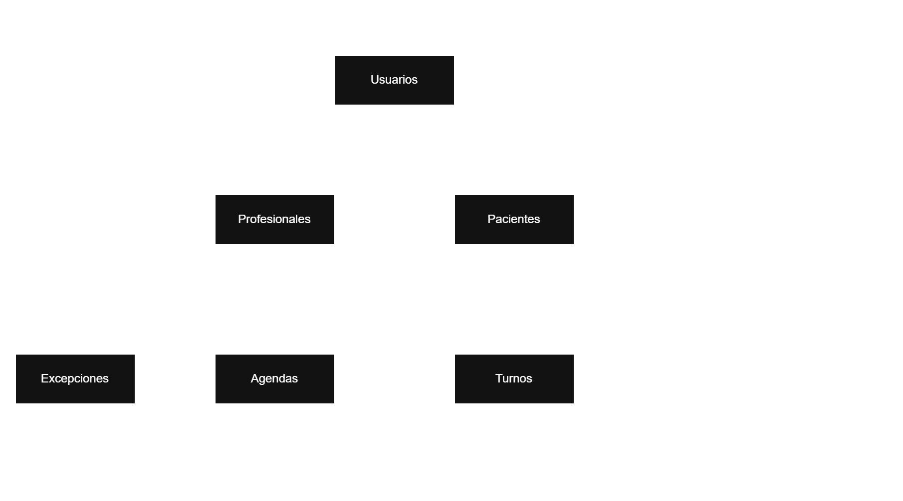

# PAUSA - Sistema de gestión de turnos

**Desarrollado por:** GASSMANN, Paulina.  
**Año:** 2026  
**Materia:** Taller de Integración.  
**Profesores:** ARREJÍN, Martín; DÍAZ, Santiago y RÍOS, Marcos.  

Sistema web desarrollado para la administración de turnos de una clínica de salud mental, permitiendo la gestión diferenciada de roles (Administrador, Secretarios, Profesionales y Pacientes)

## Tecnologías Utilizadas
- **Frontend:** HTML5, CSS3, JavaScript.
- **Backend:** PHP (con PDO para consultas seguras).
- **Base de Datos:** MySQL / phpMyAdmin.
- **Entorno de Servidor:** XAMPP (Apache).

## Requisitos del Sistema
Para poder ejecutar este proyecto localmente, necesitas tener instalado:
1. **XAMPP** (versión recomendada con PHP 8.x o superior).
2. **Navegador web actualizado** (Google Chrome, Firefox, etc.).

## Guía de Instalación y Configuración local
Para ejecutar este proyecto en tu computadora, seguí estos pasos:
1. **Clonar o descargar el proyecto:**
   - Colocá la carpeta del repositorio dentro del directorio `htdocs` de tu XAMPP (`C:/xampp/htdocs/sistema-de-turnos`).
2. **Iniciar servicios:**
   - Abrí el panel de control de XAMPP y encendé los servicios de **Apache** y **MySQL**.
3. **Importar la Base de Datos:**
   - Ingresá a `http://localhost/phpmyadmin/`.
   - Creá una nueva base de datos con el nombre exacto: `sistema_turnos`.
   - Entrá a esa base de datos recién creada, andá a la pestaña **Importar**, seleccioná el archivo `.sql` que se encuentra dentro de la carpeta `db/` de este repositorio y hacé clic en **Continuar**.
   - En caso de algún error para importar, puedes pegar el código del archivo `.sql` que se encuentra dentro de la carpeta `db/` de este repositorio en la base de datos creada en php my admin y se creará la estructura de tablas.
4. **¡Listo para usar!**
   - El sistema ya cuenta con el archivo de conexión (`config/conexion.php`) preconfigurado para las credenciales estándar de XAMPP (`root` sin contraseña). Abrí tu navegador y entrá a:
     `http://localhost/sistema-de-turnos/`

## Manual de Usuario Básico
- **Administrador:** Puede gestionar los respaldos de la base de datos y dar de alta secretarios.
- **Secretario/a:** Puede dar de alta pacientes y profesionales, gestionar agendas y asignar turnos.
- **Profesional:** Puede visualizar sus horarios y agenda asignada. Se tomó esta decisión con el fin de no cargar a los profesionales con la gestión administrativa.
- **Paciente:** Puede reservar y cancelar turnos desde su panel.

## Manual de Uso del Sistema
El sistema cuenta con un control de acceso basado en roles. A continuación se detalla el funcionamiento y las acciones disponibles para cada tipo de usuario:

### Rol: Administrador
El administrador es el encargado del mantenimiento técnico y la configuración general de la clínica.
- **Gestión de Respaldos (Backup):** Desde su panel principal, cuenta con un botón exclusivo para generar y descargar un respaldo seguro (`.sql`) de toda la base de datos en tiempo real.
- **Alta de Secretarios:** Permite registrar las credenciales de los usuarios con rol de secretaría para que puedan operar el sistema.

### Rol: Secretario
Es el núcleo administrativo del sistema, encargado de la atención diaria y la organización de la clínica.
- **Gestión de Profesionales:** Permite dar de alta a nuevos profesionales de la salud mental en el sistema, asignando sus datos personales y especialidad.
- **Gestión de Pacientes:** Permite registrar nuevos pacientes o editar sus datos de contacto (DNI, teléfono normalizado, correo electrónico, etc.).
- **Configuración de Agendas:** Define los días de la semana, horarios de inicio/fin y duración de los turnos para cada profesional. También permite registrar excepciones o días no laborables.
- **Otorgamiento de Turnos:** Asigna turnos a los pacientes según la disponibilidad de la agenda del profesional seleccionado.
- **Control de Turnos:** Visualiza los turnos del día y actualiza sus estados (atendido, ausente, cancelado).

### Rol: Profesional (Psicólogo/a)
Diseñado para facilitar la consulta de su propia información sin carga administrativa.
- **Visualización de Agenda:** Al iniciar sesión, el profesional puede consultar de forma clara sus horarios asignados, los días laborales y los pacientes que tiene citados.
- **Enfoque Clínico:** Se prioriza que el profesional no deba lidiar con la gestión de altas o reprogramaciones complejas, delegando esa tarea en la secretaría.

### Rol: Paciente
Permite a los usuarios gestionar su propia atención de manera autónoma.
- **Reserva de Turnos:** Desde su panel personal, el paciente puede visualizar los profesionales disponibles, elegir el horario que mejor se adapte a sus necesidades y reservar un turno de forma rápida.
- **Cancelación de Turnos:** Permite visualizar los turnos próximos programados y cancelarlos en caso de no poder asistir, liberando automáticamente el espacio en la agenda.

---

## Guía de Uso Detallada (Paso a Paso)

A continuación, se detalla el flujo de navegación y operación de cada pantalla del sistema Pausa:

### 1. Acceso al Sistema y Autenticación
- Ingresar en el navegador a `http://localhost/sistema-de-turnos/`.
- El sistema cuenta con una pantalla de inicio de sesión unificada. Según el rol asignado (Administrador, Secretario/a, Profesional o Paciente), el sistema redirigirá automáticamente al usuario a su panel correspondiente tras validar sus credenciales de forma segura.

### 2. Panel del Administrador
- **Generación de Respaldo (`.sql`):** Al ingresar, el administrador cuenta con un botón dedicado para descargar un respaldo actualizado de la base de datos de la clínica de forma instantánea.
- **Registro de Secretarios:** Permite completar un formulario con los datos necesarios para dar de alta nuevos usuarios con permisos administrativos de secretaría.

### 3. Panel de Secretaría (Núcleo Operativo)
Desde este panel se gestionan los cimientos de la atención diaria:
- **Gestión de Profesionales:**
  - Ir a la sección de registro de profesionales.
  - Completar los datos personales, especialidad y credenciales.
- **Gestión de Pacientes:**
  - Registrar nuevos pacientes ingresando DNI, nombre, apellido, correo electrónico y teléfono normalizado.
  - Editar datos existentes en caso de modificaciones de contacto.
- **Configuración de Agendas Base:**
  - Seleccionar al profesional.
  - Definir los días de atención, horarios de inicio y fin, y la duración estimada de cada turno.
- **Gestión de Excepciones:**
  - Bloquear días específicos (feriados, vacaciones o licencias) en los que el profesional no atenderá.
- **Otorgamiento de Turnos:**
  - Seleccionar al paciente y al profesional deseado.
  - El sistema mostrará los horarios disponibles según la agenda configurada para asignar el turno.
- **Control de Turnos del Día:** 
  - Visualizar la lista de turnos asignados para la jornada y actualizar sus estados (Atendido, Ausente, Cancelado, Pendiente).

### 4. Panel del Profesional
- **Consulta de Agenda:**
  - Al iniciar sesión, el profesional visualiza de forma directa su calendario y listado de pacientes citados, con el objetivo de agilizar la atención clínica sin sobrecarga administrativa.

### 5. Panel del Paciente
- **Reserva Autogestionada:**
  - Ingresar al apartado de reserva de turnos.
  - Elegir el profesional de salud mental disponible y seleccionar el horario que mejor se adapte a su comodidad.
- **Cancelación de Turnos:**
  - Visualizar los turnos próximos programados en su historial y cancelarlos con un solo clic si no va a poder asistir, liberando automáticamente el espacio en la agenda del profesional.

## Modelo de Base de Datos (DER)
Por último, se adjunta el DER para mejor comprensión del sistema.

